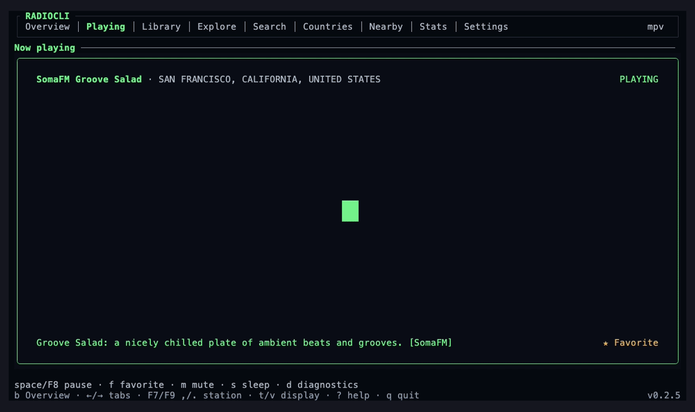
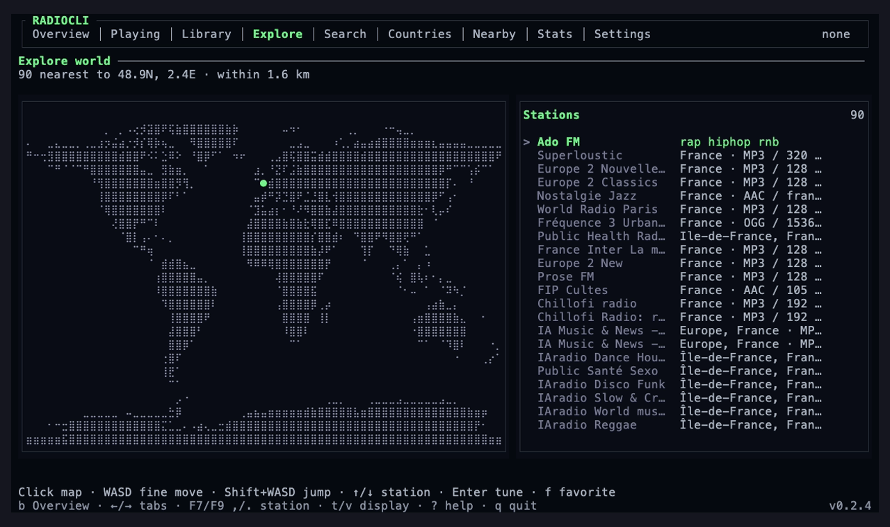
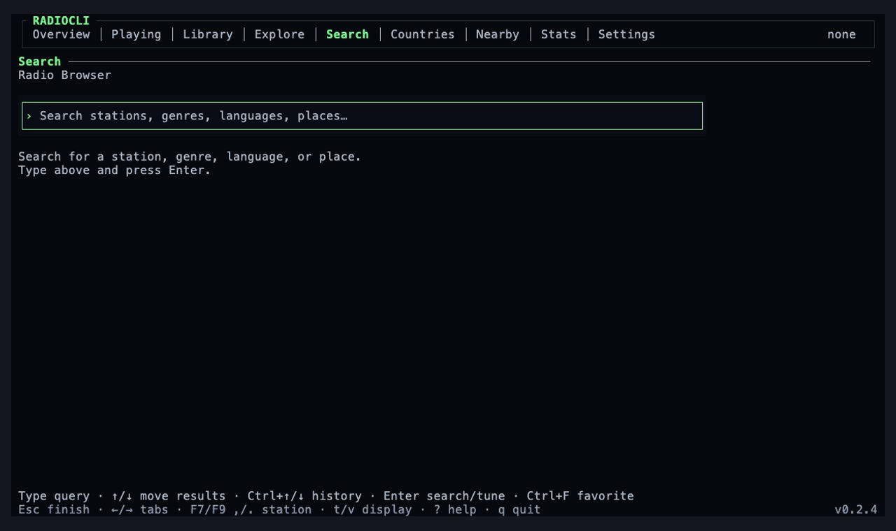
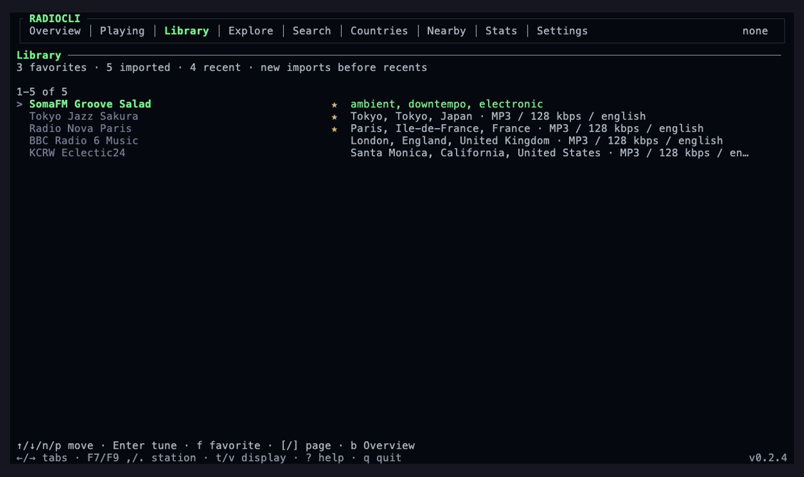
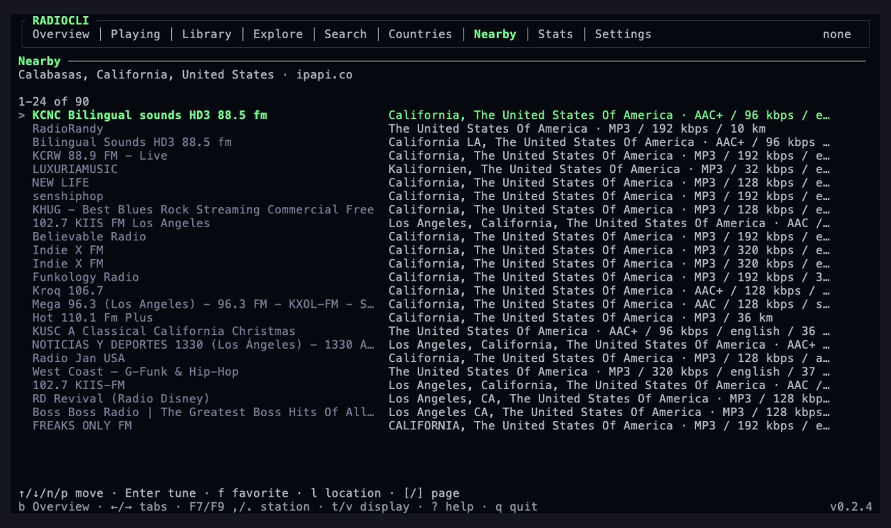
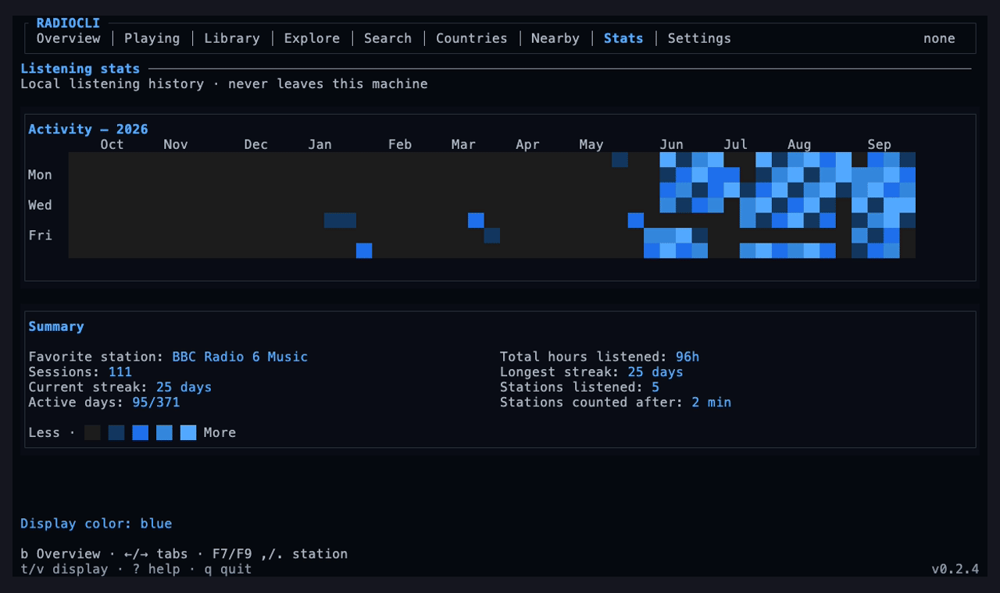

# RadioCLI

RadioCLI is an open-source internet radio player with a full-screen terminal
interface and a scriptable CLI. Discover and stream stations from around the
world without leaving your terminal. No account. No cloud library.

[](https://github.com/Ciphore/RadioCLI/actions/workflows/ci.yml?query=branch%3Amaster+event%3Apush)
[](LICENSE)
[](package.json)



## Features

- **Station discovery:** Search by name or genre, filter by country, language,
  codec, and bitrate, or browse country lists. The interactive world map uses a
  cached station atlas to find broadcasts around the map cursor and sort them by
  distance. Cached directory results remain available during provider outages.
- **63 receiver styles:** Switch between braille animation, ASCII geometry,
  waves, fire, cityscapes, and the Gallop display without interrupting
  playback. Color themes are selected independently. Receivers animate during
  active playback and return to a zero-signal display when audio is inactive.
- **Listening stats:** A 52-week activity graph, listening time, session counts,
  active days, streaks, and your most-listened station. Stats are recorded locally
  across TUI and CLI listening sessions.
- **Alarms (beta):** One-time and recurring schedules with timezones, independent
  volume, fade-in, fallback stations, snooze, and auto-stop. Native OS scheduling
  allows alarms to run after the terminal closes. See the
  [alarm guide](apps/docs/content/docs/alarms.mdx) for setup and power requirements.
- **Agent control:** An optional Model Context Protocol (MCP) server exposes
  typed tools for discovery, playback, favorites, stats, alarms, AirPlay, and
  appearance. Coding assistants can operate RadioCLI directly; `radiocli agent`
  provides the same controls for other local tools.
- **Terminal support:** Full, compact, and micro layouts adapt to window resizing.
  Keyboard, mouse, and trackpad controls work alongside Unicode and ASCII
  rendering, reduced motion, screen-reader output, transparent backgrounds, and
  limited-color or `NO_COLOR` environments. Offline browsing and low-bandwidth
  modes are also supported.
- **Playback:** Pause, volume, mute, and live track metadata through `mpv`, with
  configurable media keys and a sleep timer. Previous and next follow the station
  list you tuned from. Track history and stream diagnostics are available in
  the TUI.
- **Nearby stations:** Discover stations around an approximate location and
  browse them by distance. Location lookup runs when you open Nearby and can be
  disabled in Settings.
- **Local library:** Save favorites, revisit recent stations, and manage imports
  in one place. Settings, track history, and listening data stay on your machine,
  with JSON backup and restore. No account is required.
- **AirPlay (experimental):** Discover network receivers and switch audio output
  from the TUI, including passcode entry when required. Availability depends on
  the platform and receiver; see [supported setups](apps/docs/content/docs/platforms.mdx).
- **Custom stations:** Add direct HTTP(S) stream URLs with automatic ICY metadata
  lookup. Import M3U, PLS, or XSPF playlists and export an M3U library.
- **Shell commands:** Start background playback by station name, save named
  presets, and watch the current track from your prompt. Shell completion and
  JSON or plain output support interactive use and scripting.

## Quick start

**Homebrew**

```bash
brew install ciphore/tap/radiocli
radiocli
```

**npm · Node.js 22 or newer**

```bash
npm install -g @ciphore/radiocli
radiocli setup
radiocli
```

Setup helps install the playback tools for your system. See
[installation](apps/docs/content/docs/getting-started/install.mdx) for other
routes and [platform support](apps/docs/content/docs/platforms.mdx) for
macOS, Linux, Windows, and BSD details.

Launch `radiocli`, open Search or Explore, select a station, and press `Enter`
to start playback.

| Key | Action |
| --- | --- |
| `←` / `→` | Switch screens |
| `↑` / `↓`, then `Enter` | Select and tune a station |
| `space` | Pause or resume |
| `f` | Toggle a favorite |
| `v` / `t` | Change receiver style / color theme on Playing |
| `?` / `q` | Show shortcuts / quit |

The footer shows controls for the current screen. See the
[controls guide](apps/docs/content/docs/getting-started/tui-controls.mdx) for
filters, station skipping, media keys, and the command palette.

## Screenshots

**Explore:** Move the map cursor with WASD or click a location to list stations
by distance.



**Search:** Browse results with station names, countries, codecs, and bitrates.



**Library:** Switch between favorites, recent stations, and imported streams.



**Nearby:** Browse stations around your approximate location.



**Stats:** Review listening activity and totals, with selectable display colors.



## CLI and agent control

```bash
radiocli play jazz
radiocli now
radiocli favorite
radiocli stop
```

`play` starts background playback and returns to your prompt. If the TUI is
already open, commands control its player instead. Both interfaces use the same
library, metadata, and listening history. Use `radiocli help` for common commands
or `radiocli help --all` for the full reference.

Run `radiocli setup --mcp` to configure the optional local MCP integration for
coding assistants. Ordinary CLI playback does not require MCP setup. The
[CLI and agent guide](apps/docs/content/docs/getting-started/cli.mdx) covers
commands, presets, shell completion, and integration details.

## Documentation

[Getting started](apps/docs/content/docs/index.mdx) ·
[Controls](apps/docs/content/docs/getting-started/tui-controls.mdx) ·
[Alarms](apps/docs/content/docs/alarms.mdx) ·
[Troubleshooting](apps/docs/content/docs/troubleshooting.mdx) ·
[Architecture](apps/docs/content/docs/architecture.mdx)

Your library and listening history stay on your machine. Read
[Privacy and security](apps/docs/content/docs/privacy-security.mdx) for the
network requests and data flow.

Want to contribute? [CONTRIBUTING.md](CONTRIBUTING.md) covers development and
checks. RadioCLI is [MIT licensed](LICENSE).

---


